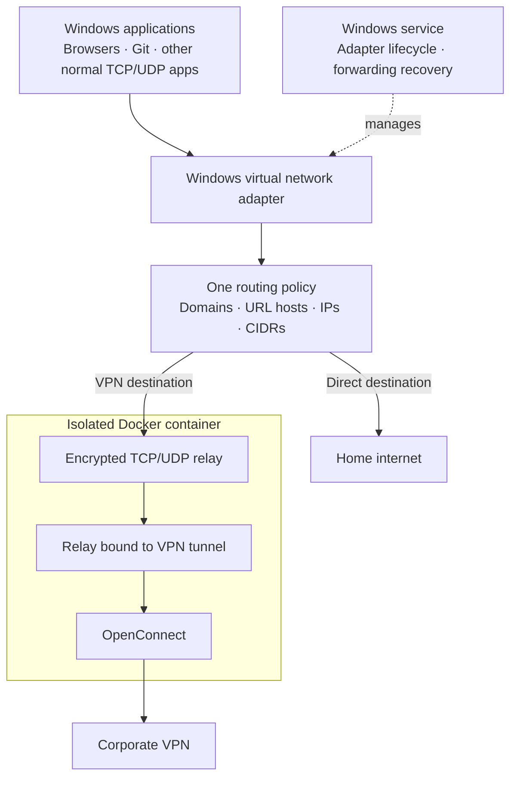
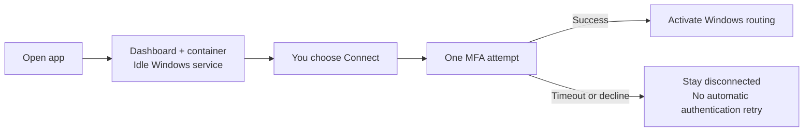

# Split VPN Router

A Docker-contained OpenConnect VPN with a native Windows routing service.

Put a domain, URL, IP or CIDR in `vpn.list` to send its connections through your VPN. `direct.list` selects your home network. The Windows virtual adapter handles TCP and UDP without requiring applications to understand PAC files or proxy environment variables. HTTP Git and SSH Git use the same policy.

The repository and checkout are named `split-vpn-router`. Historical Windows installation/data/registry names and MSI release asset filenames remain stable for upgrades. The tool no longer provisions, launches or modifies a WSL distro. Docker Desktop manages its own backend. If you also want WSL absent from Windows, choose a Docker backend supported by your Windows edition, such as Hyper-V. The installer leaves Docker's backend alone.

## How routing works

Windows networking applies one routing policy to normal application TCP/UDP traffic. Apps do not need separate proxy settings. Corporate DNS also travels through the VPN relay.



The previous design depended on each app reading PAC, environment or Git proxy settings. Some apps ignored those settings or cached them until restart. The native adapter removes that dependency for normal Windows traffic; Docker contains the VPN runtime.

## Connection behavior

Opening the app prepares the dashboard and idle service. Only an explicit Connect action initiates VPN authentication; routing starts after authentication succeeds.



- Installation, tray startup and container restart never log in to the VPN.
- Up/Connect initiates one password authentication attempt.
- `vpn.auto_reconnect = false` is the default. Timeouts and declined MFA leave the VPN disconnected.
- Enabling reconnect permits transport recovery with the existing cookie only, never another password login.
- While the routing service remains active, VPN-selected traffic fails when the VPN is unavailable; direct traffic remains direct.

## Installation

Requires Windows x64, Docker Desktop running Linux containers, and administrator approval for the routing service/virtual adapter. Docker alone cannot intercept Windows applications.

The published installer is:

```powershell
irm https://raw.githubusercontent.com/Murhaf-Mo/split-vpn-router/main/install.ps1 | iex
```

That URL installs the latest **published release**, not unreleased checkout changes. To build this checkout, use native Windows Go 1.25 or newer:

```powershell
.\build.ps1
.\vpn.exe configure
.\vpn.exe up
.\vpn.exe add https://internal.example.com
.\vpn.exe dashboard
.\vpn.exe down
```

Installation opens the dashboard and tray automatically. Opening the app or running `vpn dashboard` prepares an idle Windows service and builds/starts the Docker runtime without authenticating or changing routes. Choose Connect (or run `vpn up`) for one explicit MFA attempt; Windows routing activates after authentication succeeds. Configuration and logs stay outside the image. Changed image sources trigger a rebuild on the next start.

Windows IP forwarding can cause a virtual-adapter routing loop. Up detects that conflict before authentication. Opt into `routing.manage_forwarding = true` to pause forwarding on the outbound adapter while routing and restore it on stop or crash; hotspot/machine forwarding may pause during the session. It is disabled by default.

## Routing boundaries and migration

URL inputs route the entire host. Encrypted HTTPS paths/query strings cannot be universal packet-routing rules. Existing sockets cannot move seamlessly between networks; policy replacement can reconnect them.

Domain routing uses intercepted DNS, Windows hosts-file mappings and protocol sniffing. Applications combining encrypted DNS with hidden hostnames, raw sockets or explicitly bound interfaces can need IP/CIDR rules or specific settings. This is not a guarantee that every possible network stack is intercepted.

Before upgrading from the old release, stop it with its `vpn down`. The new controller backs up/removes recognized legacy PAC/environment/Git proxy settings. Apps already caching those settings may need one restart during migration. Unrelated proxies are preserved.

## Verification status

Automated tests cover authentication/reconnect policy, configuration migration, API authorization, rule generation and legacy proxy recognition. The pinned engine validates generated configurations and exercises encrypted TCP/UDP transport. Docker startup, isolated IPv4/IPv6 route hooks, DNS preservation and passive restart passed.

Live Windows checks on 2026-10-15 passed service installation/permissions, adapter startup, forwarding management/restoration after normal stop and forced termination, corporate MFA, public HTTPS/Git, corporate HTTPS, UDP corporate DNS, URL-rule reload without another login, and direct connectivity with VPN destinations blocked after disconnect. Browser/API dashboard checks passed without authentication. Sleep/resume, network switching and long session expiry still need separate testing; these results do not guarantee every application's network stack.

See [documentation](docs/README.md), [architecture](docs/architecture.md) and [troubleshooting](docs/troubleshooting.md).

## License

Personal-use. The separately executed sing-box engine includes its own bundled license; upstream source is at https://github.com/SagerNet/sing-box/tree/v1.14.3.
